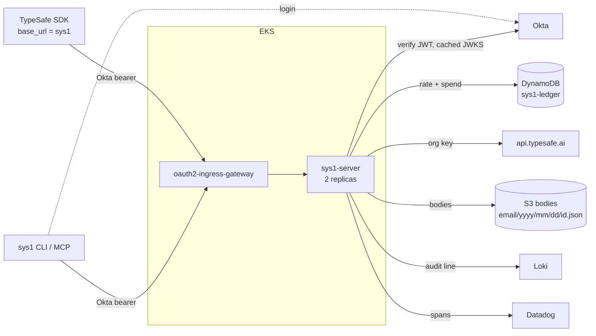

|  |  |
| --- | --- |
| **Author** | Scott Idler |
| **Date** | 2026-10-19 |
| **Team** | SRE |
| **Spec type** | **Standalone** |
| **Status** | Draft |
| **PRD** | **None.** The Problem section carries the WHAT and the WHY. |
| **Design** | **None.** No UI: an HTTP API, a CLI, and an MCP server. |
| **Jira Epic** | [AIF-118](https://tatari.atlassian.net/browse/AIF-118) |
| **Approvers** | Security (SEC-####), SRE (SRE-####) |
| **Stakeholders** | IT (TypeSafe console admin, mints the one key). AI Foundry (AIF-28). Engineers writing skills and scripts that call Jev. |
| **Review date** |  |

<Info>
  Design doc and implementation notes live in `tatari-tv/sys1` under `docs/design/`. [PR #2](https://github.com/tatari-tv/sys1/pull/2) holds the build.
</Info>

## Problem

### Why

- Engineers want <Tooltip tip="TypeSafe's System One decision model: fast, automatic, no deliberation.">Jev</Tooltip> in automation: Claude skills, scripts, agents. The vendor review passed (SEC-3117, SEC-3102).
- TypeSafe offers API keys only. No SSO, no SCIM, no RBAC, no customer-facing audit log. Rate limits are per org. SEC-3102 accepted those gaps "for now".
- Today calling Jev means holding a TypeSafe key. The org key on N laptops is the master key on N laptops; IT-minted personal keys outlive Okta offboarding and are attributable only inside the vendor console.
- Nothing records who asked Jev what. SEC-3117's bar is parity with the Claude Enterprise controls: Okta SAML, SCIM, an audit log.
- Every caller has to remember the same policy: pin a model, check the answering `model`, back off on 429.
- Adjacent: AIF-28 puts Claude, Gemini, and GPT behind Bedrock. Jev is not a Bedrock model, so neither effort blocks the other.

### What

Any Okta-authenticated employee calls Jev with their own Okta token, from the stock TypeSafe SDKs, the `sys1` CLI, or an MCP tool in Claude, and never sees the org key. The server pins the model, caps rate and daily spend per user, and keeps a record of every call under the caller's verified email, which they can read back and nobody else can.

## Summary

sys1 is an axum service on EKS behind the shared Okta gateway. It holds Tatari's single TypeSafe key, verifies the caller's Okta token in the pod, swaps the bearer for the org key, and forwards to `api.typesafe.ai` with the wire contract unchanged. Policy lives in the server: model pin and allowlist, a per-user rate limit and daily spend cap in a DynamoDB ledger, one audit line per call to Loki, and both bodies in S3 under the caller's email.

`sys1` is the CLI (`login | token | ask | models | logs | mcp`), and `sys1 mcp serve` is a stdio MCP server with the same three tools. The shape is classifier.dev's (an API in front of Jev, no key for the caller), gated by Okta, with limits and a record of our uses.

<Columns cols={2}>
  <Card title="Goals" icon="bullseye">
    - One TypeSafe key, server-side, delivered by External Secrets. Nothing shipped to a laptop contains it.
    - Any employee's Okta token works from an unmodified TypeSafe SDK. A machine token is refused. Offboarding cuts access within the token's lifetime.
    - The caller gets the pinned model whatever alias they asked for; an answer from any other model is withheld.
    - Per-user rate and spend caps hold exactly across two replicas.
    - Every call leaves one audit line and one S3 object under the verified email; a caller can read their own and nobody else's.
  </Card>

  <Card title="Non-goals" icon="ban">
    - A token vend (sys1 never hands out the key), or part of valet.
    - classifier.dev's surface: labels API, LLM tier, chunking, scraping, non-Jev models.
    - A new API shape. sys1 adds no field to the TypeSafe request or response.
    - A query layer over the bodies. `sys1 logs` lists the S3 prefix.
  </Card>
</Columns>

### Assumptions

- Okta access tokens here carry the email in `sub` and a `uid` claim on user tokens only; lifetime 12 h (tenant policy).
- The `oauth2-ingress-gateway` passes a bearer-carrying request through and redirects a header-less one. The gateway-to-pod hop is mesh mTLS, as for valet and marquee.
- Pod stdout goes to Loki with 1-year retention; Datadog collects no container logs on these clusters, so log alerts are Loki ruler rules.
- The Backstage `s3` mixin gains a versioning toggle and a write-once access level (platform-templates PR in flight). The bucket waits on it.
- TypeSafe's rate limit is per org. sys1 does not change that; it makes a 429 attributable and bounds any one caller.

### Dependencies

| Dependency | Owner | Why |
| --- | --- | --- |
| `okta-verify-rs` (new shared crate) | SRE | server-side JWT verification, hardened JWKS cache |
| `okta-auth`, `mcp-io`, `renew` | SRE | the fleet's CLI crates |
| Okta `default` authorization server, audience `api://default` | IT / Security | the same login every fleet CLI uses |
| TypeSafe API | vendor | upstream |
| DynamoDB table `sys1-ledger` | platform-infra PR, valet's hand-written precedent | counters |
| S3 bucket `bodies` | Backstage `s3` mixin plus the pending access-level parameter | bodies |
| Standard mixins (irsa, ecr, external-secrets, eks-deployment, argocd, github-actions, release-settings, datadog) | SRE | deploy |

## Proposed solution

One org key, server-side. The caller's Okta token is the credential; the server verifies it, enforces policy, forwards with the org key, counts, and records.

### The six key decisions

<CardGroup cols={2}>
  <Card title="1. Keep TypeSafe's wire contract" icon="plug">
    The stock SDKs work with `base_url` pointed at sys1 and the Okta token as the "API key". No sys1 client library, nothing for callers to learn.
  </Card>

  <Card title="2. Verify the token in the pod" icon="key">
    Not just at the gateway. The verified identity is the S3 key prefix, so authorization for reading bodies is the key itself; there is no way to name another user.
  </Card>

  <Card title="3. Counters in DynamoDB" icon="calculator">
    Two replicas must agree on a limit. Atomic `ADD` with TTL, admission before forwarding, fail closed when the ledger is down, undercount rather than double-bill when it fails after the answer.
  </Card>

  <Card title="4. Bodies in S3, metadata in Loki" icon="box-archive">
    A body can be 32 MiB and does not belong in a log pipeline. S3 lifecycle is the retention control Security already understands. The pod can put, get, and list; never delete.
  </Card>

  <Card title="5. Model policy in the response path too" icon="shield-check">
    The pin rewrites the request; the check on the answered `model` catches the vendor moving under us. Spend comes from the response's `usage`, so a gateway rate limiter could never do this job.
  </Card>

  <Card title="6. Zero-drop rollouts" icon="rotate">
    One shutdown window, validated at startup to cover the slowest call, under the pod's 30 s grace.
  </Card>
</CardGroup>

### System architecture



Repo: a Cargo workspace copied from marquee (`core`, `contract`, `server`, `cli`, test support), one flat `v*` tag. Fleet precedents: valet (Okta-gated axum, audit line, hand-written DynamoDB), marquee (workspace, JWKS hardening), slack-cli (CLI with the okta-auth token).

### Data model

<AccordionGroup>
  <Accordion title="DynamoDB: sys1-ledger" defaultOpen icon="database">
    Partition key `pk`, TTL attribute, on-demand. Two key shapes: `rate#<email>#<minute>` holding a count, and `spend#<email>#<day>` holding input tokens. Items expire within two days. IAM: `UpdateItem` and `GetItem` on this table only.
  </Accordion>

  <Accordion title="S3: bodies bucket" defaultOpen icon="bucket">
    One object per call that passed the identity gate, keyed `<email>/<yyyy>/<mm>/<dd>/<request_id>.json`. The request id is a UUIDv7, so the date comes from the id and a read rebuilds the key from the id plus the verified email. The object holds the metadata (ids, models, statuses, usage, cost, decision) and both bodies. Private, SSE-S3, 365-day expiry (Data Retention Policy, pod-log row), versioned with a 1-day noncurrent expiry. IAM: put, get, list; no delete.
  </Accordion>

  <Accordion title="Audit line" icon="file-lines">
    One JSON line per call to stdout, the same metadata as the object, never a body or token. `decision` is one word for how the call ended and equals the error body's `error_type`: `ok`, a refusal (`unauthorized`, `rate_limited`, `cap_exceeded`, `bad_request`, ...), an upstream outcome (`upstream_rejected`, `upstream_unauthorized`, `upstream_error`, `model_rejected`), or a dependency failure (`ledger_unavailable`, `identity_unavailable`, `store_unavailable`, `shed`).
  </Accordion>

  <Accordion title="Config" icon="sliders">
    Env only, validated at startup. Defaults: 120 calls/min, \$5.00/day, model pin `jev-1.13.0` with `jev-1.14.0` allowed, 32 MiB body cap, 12 s upstream timeout, 16 in flight per pod, 25 s shutdown window.
  </Accordion>
</AccordionGroup>

### Data flow

<Tabs>
  <Tab title="POST /v1/systemone">
    The happy path and where each refusal exits:

    ```mermaid
    sequenceDiagram
autonumber
participant C as Caller (SDK / CLI)
participant G as Okta gateway
participant R as sys1-server
participant D as DynamoDB
participant T as TypeSafe
participant S as S3

C->>G: POST /v1/systemone, Okta bearer
G->>R: forward (no bearer -> 302 at the gateway)
R->>R: verify JWT locally (401), header policy (400/415)
R->>D: ADD 1 to rate#email#minute
D-->>R: count (over -> 429 rate_limited)
R->>D: GET spend#email#day
D-->>R: tokens (at cap -> 429 cap_exceeded. Ledger down -> 503, nothing forwarded)
R->>R: decompress, cap 32 MiB, resolve model (unknown -> 400)
R->>T: POST /v1/systemone, org key, pinned model
T-->>R: answer (non-2xx passes through. 401 -> 502 upstream_unauthorized)
R->>R: answered model == pinned? (no -> 502 model_rejected, body withheld)
R->>D: ADD usage.input_tokens to spend#email#day
Note over R,D: ADD fails after a billed answer -> response unchanged, spend_counted=false
R-->>C: status + body, x-sys1-request-id
R->>R: emit audit line
R-)S: put bodies (bounded queue, never changes the response)
    ```

    Refusals happen before any body byte is read, in the order shown. Forwarding has no retries and no redirects, so the org key only ever goes to the configured URL; the SDKs do their own 5xx retries.
  </Tab>
  <Tab title="GET /logs">
    `GET /logs?date=` and `GET /logs/<id>`:

    ```mermaid
    sequenceDiagram
participant C as Caller
participant R as sys1-server
participant S as S3
C->>R: GET /logs/<id>, Okta bearer
R->>R: verify JWT, then key = verified email + date from the UUIDv7 id
R->>S: GetObject(key)
S-->>R: object, or missing
R-->>C: 200 body, or 404 (another user's id looks the same)
    ```
  </Tab>
  <Tab title="SIGTERM">
    Shutdown on SIGTERM:

    ```mermaid
    sequenceDiagram
participant K as Kubernetes
participant R as sys1-server
participant S as S3
K->>R: SIGTERM (pod leaves the Service)
Note over R: keep accepting 3 s while the gateway catches up
R->>R: close listener, finish in-flight calls
R->>S: drain the store queue
Note over R: one 25 s window from the signal, validated to cover delay + ledger + upstream + put, under the 30 s grace
R-->>K: exit 0
    ```
  </Tab>
</Tabs>

<Note>
  At one replica nothing is simpler; at two nothing diverges: the only shared mutable state is the ledger and the bucket. Accepted imprecision: a fixed-minute rate window lets one caller burst twice the limit across a boundary, and the spend cap overshoots by the tokens in flight.
</Note>

### APIs and interface changes

New service, nothing existing changes.

| Route | Auth | Behavior |
| --- | --- | --- |
| `POST /v1/systemone` | Okta bearer | the proxy |
| `GET /v1/models` | Okta bearer | forwarded with the org key |
| `GET /logs?date=YYYY-MM-DD`, `GET /logs/<id>` | Okta bearer | the caller's own calls |
| `/health`, `/ready` | none | ready iff the JWKS cache holds keys |
| `/version`, `/deployed`, `/status` | none | the fleet's standard routes |

Errors use TypeSafe's own `{"detail": {"error_type", "message"}}` shape, so the SDKs raise the same exceptions.

<Tabs>
  <Tab title="Existing script">
    The whole integration for an existing script:

    ```bash
    export TYPESAFE_BASE_URL=https://sys1.internal.tatari.dev
    export TYPESAFE_API_KEY=$(sys1 token)
    python my_existing_jev_script.py   # unchanged
    ```
  </Tab>
  <Tab title="CLI">
    `sys1 login | logout | whoami | token | renew | ask | models | logs | mcp`. Yaml on a terminal, json when piped.

    ```bash
    sys1 login
    sys1 ask --questions questions.yml --state "the text to judge"
    sys1 logs --date 2026-10-19
    sys1 logs <request-id>
    ```
  </Tab>
  <Tab title="MCP">
    `sys1 mcp serve` (stdio) exposes `ask | models | logs`, the same functions as the CLI; `plugin/` ships the Claude skills through tatari-skills.
  </Tab>
</Tabs>

### New technology

- Nothing new on the platform side: axum on EKS, DynamoDB, S3, External Secrets, IRSA, Loki, Datadog are all in the fleet.
- TypeSafe is the new vendor, reviewed and accepted.
- `okta-verify-rs` is a new shared crate: the server-side verifier with marquee's <Tooltip tip="JSON Web Key Set: Okta's published signing keys, cached in the pod.">JWKS</Tooltip> hardening, for valet and marquee to adopt later.

## Testing

Unit and integration suites per crate; trait contract suites run against in-memory fakes and the AWS implementations (the live runs wait for the test bucket and table); every phase's tests were seen failing before the fix; a workspace mutation run reports zero missed. Nothing is deployed yet, so end to end is Phase 9: SDK calls, a rate trip and a cap trip across both pods, `sys1 logs`, an alert tripped on purpose, and `sdv probe`.

## Monitoring and observability

- **Logs:** JSON to stdout, shipped to Loki; the `audit` line per call plus one line per settled S3 put, both pinned past the log level. No bearer, key, or body in any line.
- **Spans:** OTLP to the Datadog agent with request id, email, status, decision.
- **Probes:** `/ready` is the JWKS cache warm; `/health` is process up.
- **Alerts** (proposed; Loki ruler rules in gitops-infra, thresholds set after a week on test, P3 to Slack until prod has traffic): any `upstream_unauthorized` (key rotated under us); `ledger_unavailable` or `identity_unavailable` sustained; any `model_rejected` (vendor moved); any billed call uncounted; store puts failing; upstream 429 rate (org limit hit, lines name who); 5xx and shed rate; all pods not ready.

## Scale and performance

Low and unmeasured: a handful of callers, mostly the author's tag classifier. Jev answers in 70-500 ms; sys1 adds a local verify, three DynamoDB calls, and an async S3 put. Bounds: 16 in flight per pod, two pods, 32 MiB each way, 2Gi per pod (sized from the bounds; peak RSS measured on test before the prod tag).

## Reliability and resilience

| Failure | Behavior |
| --- | --- |
| TypeSafe down or slow past 12 s | 502; the SDKs retry |
| TypeSafe rejects the org key | 502 `upstream_unauthorized`, alert |
| TypeSafe answers with another model | 502, body withheld and kept, billed |
| DynamoDB down before forwarding | 503, nothing forwarded; cap fails closed |
| DynamoDB down after a billed answer | answer returned, spend uncounted, alert |
| S3 slow or down | bounded queue, then backpressure; never a 5xx to the caller |
| Okta JWKS unreachable | cached keys served; a cold pod stays not-ready |
| Pod over the in-flight bound | 503 shed with `retry-after` |
| Rollout | the shutdown window above; zero dropped requests at the defaults |

Two replicas with preferred anti-affinity and a PodDisruptionBudget (`minAvailable: 1`; the platform-service chart gains an opt-in key). HPA off: its CPU target does not track the in-flight bound, so a sustained shed alert means a manual replica raise.

## Rollout and rollback

<Steps>
  <Step title="Merge to main" icon="code-merge">
    Deploys to `test`. No migration: nothing calls Jev through Tatari infrastructure today.
  </Step>
  <Step title="Tag" icon="tag">
    A `v*` tag promotes the same digest to prod.
  </Step>
  <Step title="First users" icon="users">
    The author, then the engineers who asked for Jev, after a week of prod traffic with no rollback trigger.
  </Step>
  <Step title="Rollback" icon="rotate-left">
    The previous tag. Triggers: `/ready` failing, any `internal` decision, uncounted billed calls with a healthy ledger, a sys1-owned 5xx rate the previous version did not show. `upstream_unauthorized` is not a rollback trigger: the fix is the key.
  </Step>
  <Step title="Key rotation" icon="key">
    New value in Secrets Manager, External Secrets syncs, `rollout restart`.
  </Step>
</Steps>

## AWS cloud cost analysis

Negligible at the known workload. Two pods per environment on shared nodes; DynamoDB on-demand at three requests per call (under \$1/day even at 100,000 calls/day); S3 at one small object per call (about 71 GiB after a year at 100,000 calls/day, under \$2/month). TypeSafe is \$0.042 per million input tokens, bounded by users x \$5.00 x days; the \$1,000 credit draws first. Levers if it grows: the daily cap and the bucket's expiry.

## Security and privacy

sys1 is the answer to the three gaps SEC-3102 accepted: no SSO, no SCIM, no audit log.

- **Authentication:** the Okta token is verified in the pod (signature, issuer, audience, expiry); identity is the verified `sub`, never a header or field. Machine tokens are refused. Offboarding bound is the 12 h token lifetime, the same as valet.
- **Authorization:** reading bodies is bounded by the S3 key built from the verified email. An admin reads another user's bodies only with a reason recorded in an ITHELP ticket; nothing standing, no admin view.
- **Key custody:** one key in Secrets Manager via External Secrets, read once, redacted, used in one place. The CLI links no server code. Upstream headers are allowlist-only both ways, no redirects, so neither the caller's bearer nor the org key goes anywhere unintended.
- **Data:** stored bodies are **Internal Use** (Data Classification Policy). A Jev call is a classifier call; the only free text is the work data being classified. Restricted and Confidential data does not go to Jev, the bar SEC-3117 set. Controls met: TLS and mesh mTLS in transit, SSE at rest, 365-day expiry, access on a stated reason only. The vendor's zero data retention is about their side; keeping our own record is a decided item.
- **Least privilege:** two DynamoDB actions on one table, three S3 actions on one bucket, no delete anywhere.
- **Attack surface:** fixed upstream URL (no SSRF); identity cannot carry a path separator and `/logs` inputs are validated to one spelling (no injection); body caps, in-flight bound, bounded queue, and timeouts (no exhaustion); `TypeSafe-Danger-Zone-*` headers refused (no vendor preview escape); the audit field list is asserted by test (no secrets in logs).
- **Compliance:** SOC 2 scope unchanged; no GDPR/CCPA subject data by design. Full TSR requested: Security and SRE tickets titled `Tech Spec review: sys1`.

<Warning>
  **Accepted risk, audience.** `api://default` is shared with every fleet CLI, so another Tatari service holding a user's token could replay it as that user. Accepted: valet and marquee carry the same exposure, and a replayed call is capped and recorded under that user.
</Warning>

## Execution plan

<Steps>
  <Step title="Phases 0-7: built" icon="check">
    Probe, workspace, proxy, audit and store, ledger, CLI and MCP, `/logs` and plugin, verifier. On [PR #2](https://github.com/tatari-tv/sys1/pull/2) with the audit and review folds.
  </Step>
  <Step title="Phase 8: infra and the test deploy" icon="server">
    Mixins, the hand-written ledger table, alerts, PDB. IT mints the key.
  </Step>
  <Step title="Phase 9: shakedown and prod" icon="flag-checkered">
    Shakedown on test, first tag, prod, then the tatari-skills ref bump and the `mcp-servers` line. Done when every Goal has its recorded result.
  </Step>
</Steps>

## Open questions

| # | Question | Owner |
| --- | --- | --- |
| 1 | Alert set, thresholds, severities (proposed above) | SRE, at the TSR |
| 2 | TypeSafe's org rate limit numbers (console only, unread) | author |
| 3 | Cost inputs: call volume, mean body size | author, after a week on test |
| 4 | Peak pod memory, measured on test before the prod tag | author |
| 5 | s3 mixin versioning and access-level parameters | author |
| 6 | Machine identity for CI and scheduled jobs; refused by design in v1 | deferred to the first job that needs Jev |

## Future changes (out of scope)

Images, `box`, and long context (when the vendor stops calling them jagged); machine identity (first scheduled job); a remote MCP endpoint (first client that cannot run a binary); a labels-style tool; `/logs` pagination past 1000 a day; valet and marquee adopting `okta-verify`.

## Design alternatives

| Alternative | Why not |
| --- | --- |
| Per-user TypeSafe keys from IT (status quo) | unattributable at the vendor, outlive offboarding, policy in N scripts |
| Org key on every laptop (env, keychain, MDM) | the master key on N laptops; no limits, no record; rotation touches every machine |
| OIDC token exchange at the vendor | not offered |
| Vend a credential through valet | TypeSafe has no per-user identity to mint against; the call never passes through a service we run |
| Gateway or mesh rate limiting in front of a thin forwarder | spend needs the response's `usage`, the pin needs the response's `model`, the record needs both bodies; the forwarder grows into sys1 |
| A general LLM gateway or Envoy ext-auth | models chat-completion APIs; Jev's endpoint is not one, so the three things sys1 does would each be a plugin we write |
| classifier.dev | public, keyless, retains content for training by default, may answer with non-Jev models, no Tatari vendor review |
| In-memory counters | every limit silently doubles at two replicas |
| ElastiCache for the counters | the cap fails closed, so counter-store downtime is sys1 downtime; the fleet's single-node shape sits under a 99.5% SLA against DynamoDB's 99.99% with no maintenance window; the latency gain is invisible beside Jev |
| CloudWatch Logs plus Athena for bodies | not in the fleet; a 32 MiB body does not fit a log event |
| Okta introspection per call | an Okta call per request to cut offboarding from 12 h to seconds; valet accepts 12 h |

## Appendix

<AccordionGroup>
  <Accordion title="References" icon="link">
    - Design doc and implementation notes: `tatari-tv/sys1` `docs/design/2026-10-18-sys1.md`, `docs/design/2026-10-18-sys1-implementation-notes.md`
    - PR #2: [https://github.com/tatari-tv/sys1/pull/2](https://github.com/tatari-tv/sys1/pull/2)
    - Jira: AIF-118, SEC-3117, SEC-3102, ITHELP-5682, ITHELP-5699, AIF-28
    - Jev field guide: marquee post `eng/typesafe-jev`; TypeSafe docs: [https://docs.typesafe.ai/api.md](https://docs.typesafe.ai/api.md)
    - Fleet precedents: valet `docs/design/2026-07-02-valet.md`; marquee; `okta-verify-rs` `docs/design/2026-10-18-okta-verify.md`
    - Policies: [Data Classification Policy](https://tatari.atlassian.net/wiki/spaces/SEC/pages/989888557), Data Retention Policy
    - Process: [Engineering Tech Specs](https://tatari.atlassian.net/wiki/spaces/ENG/pages/1673199755); [SRE Tech Spec Review Process](https://tatari.atlassian.net/wiki/spaces/SRE/pages/2721611797)
    - Prior art: [https://classifier.dev](https://classifier.dev), `github.com/alvarobartt/sys1` (an unrelated project that shares the name)
  </Accordion>

  <Accordion title="Glossary" icon="book">
    - **Jev**: TypeSafe's System One decision model; pinned versions `jev-1.13.0` and `jev-1.14.0`, moving aliases `jev-latest` and `jev-preview`.
    - **System One**: TypeSafe's name for the family: fast, automatic, no deliberation. Hence `sys1`.
    - **JWKS**: JSON Web Key Set, Okta's published signing keys; cached in the pod.
    - **IRSA**: IAM Roles for Service Accounts; the pod's AWS permissions without a key.
    - **UUIDv7**: time-ordered UUID; the request id, whose timestamp gives the S3 key date.
    - **TSR**: tech spec review. Full TSR: Security and SRE both sign the Approvers row.
    - **`decision`**: the audit line's one-word reason a call ended as it did; equals the error body's `error_type`.
  </Accordion>
</AccordionGroup>
