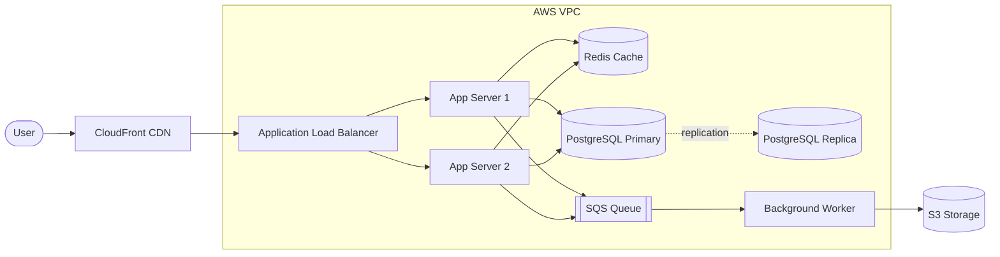

Brand new wiz bang feature

```text
// This is a code snippet
```

## Shipping soon

#### Can you see this?  Patrice? Yes I can.  We should publish this valuable info ~~ASAP<sup>3</sup>~~

export const TestChart = () => {
  const days = ["Mon", "Tue", "Wed", "Thu", "Fri", "Sat", "Sun"];
  const initialRequests = [42, 55, 61, 48, 73, 38, 29];
  const [requests, setRequests] = useState(initialRequests);
  const series = [
    { name: "Requests", color: "#3b82f6", data: requests },
    { name: "Latency", color: "#22c55e", data: [35, 47, 58, 52, 66, 41, 33] },
  ];
  const [hover, setHover] = useState(null);
  const [hidden, setHidden] = useState({});
  const W = 600, H = 280, L = 40, R = 16, T = 16, B = 32;
  const step = (W - L - R) / days.length;
  const x = (i) => L + step * i + step / 2;
  const y = (v) => T + (H - T - B) * (1 - v / 100);
  return (
    <div style={{ maxWidth: 640 }}>
      <div style={{ display: "flex", gap: 16, marginBottom: 8 }}>
        {series.map((s) => (
          <button
            key={s.name}
            onClick={() => setHidden({ ...hidden, [s.name]: !hidden[s.name] })}
            style={{ opacity: hidden[s.name] ? 0.4 : 1, cursor: "pointer", background: "none", border: "none", color: "inherit" }}
          >
            <span style={{ display: "inline-block", width: 10, height: 10, background: s.color, marginRight: 6 }} />
            {s.name}
          </button>
        ))}
      </div>
      <svg viewBox={`0 0 ${W} ${H}`} style={{ width: "100%" }} onMouseLeave={() => setHover(null)}>
        {[0, 25, 50, 75, 100].map((t) => (
          <g key={t}>
            <line x1={L} x2={W - R} y1={y(t)} y2={y(t)} stroke="currentColor" strokeOpacity="0.15" />
            <text x={L - 6} y={y(t) + 4} textAnchor="end" fontSize="11" fill="currentColor">{t}</text>
          </g>
        ))}
        {days.map((d, i) => (
          <g key={d} onMouseEnter={() => setHover(i)}>
            <rect x={L + step * i} y={T} width={step} height={H - T - B} fill={hover === i ? "currentColor" : "transparent"} fillOpacity="0.08" />
            <text x={x(i)} y={H - 10} textAnchor="middle" fontSize="11" fill="currentColor">{d}</text>
          </g>
        ))}
        {series.map((s) =>
          hidden[s.name] ? null : (
            <g key={s.name}>
              <polyline fill="none" stroke={s.color} strokeWidth="2.5" points={s.data.map((v, i) => `${x(i)},${y(v)}`).join(" ")} />
              {s.data.map((v, i) => (
                <circle key={i} cx={x(i)} cy={y(v)} r={hover === i ? 6 : 3.5} fill={s.color} />
              ))}
            </g>
          )
        )}
        {hover !== null && (
          <g>
            <rect x={Math.min(x(hover) + 10, W - 130)} y={T + 4} width="120" height="52" rx="6" fill="#111" fillOpacity="0.9" />
            <text x={Math.min(x(hover) + 20, W - 120)} y={T + 22} fontSize="12" fill="#fff" fontWeight="bold">{days[hover]}</text>
            {series.map((s, k) => (
              <text key={s.name} x={Math.min(x(hover) + 20, W - 120)} y={T + 38 + k * 14} fontSize="11" fill={s.color}>
                {s.name}: {s.data[hover]}
              </text>
            ))}
          </g>
        )}
      </svg>
      <div style={{ marginTop: 12 }}>
        <div style={{ display: "flex", justifyContent: "space-between", marginBottom: 4 }}>
          <strong>Adjust Requests</strong>
          <button onClick={() => setRequests(initialRequests)} style={{ cursor: "pointer", background: "none", border: "none", color: "inherit", textDecoration: "underline" }}>
            Reset
          </button>
        </div>
        {days.map((d, i) => (
          <label key={d} style={{ display: "flex", alignItems: "center", gap: 8, fontSize: 13 }}>
            <span style={{ width: 32 }}>{d}</span>
            <input
              type="range"
              min="0"
              max="100"
              value={requests[i]}
              onChange={(e) => setRequests(requests.map((v, j) => (j === i ? Number(e.target.value) : v)))}
              style={{ flex: 1 }}
            />
            <span style={{ width: 28, textAlign: "right" }}>{requests[i]}</span>
          </label>
        ))}
      </div>
    </div>
  );
};

<TestChart />

oh good

<Tip>
  Commit this to main.  Save early, save often.  Save money with ....
</Tip>

<Accordion title="Don't look in here">
  TOLD YOU NOT TO LOOK IN HERE
</Accordion>

## Example infrastructure

Create this with the Mintlify agent on this page.



<Steps>
  <Step title="This is one thing">
    This is the first stpe in many.
  </Step>
  <Step title="This is step 2">
    Do more here.
  </Step>
</Steps>

<Update label="10/05/2026" description="">
  ## Test

  this is an update panel
</Update>

<Visibility for="agents">
</Visibility>

/
